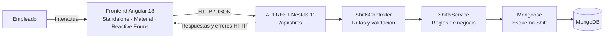
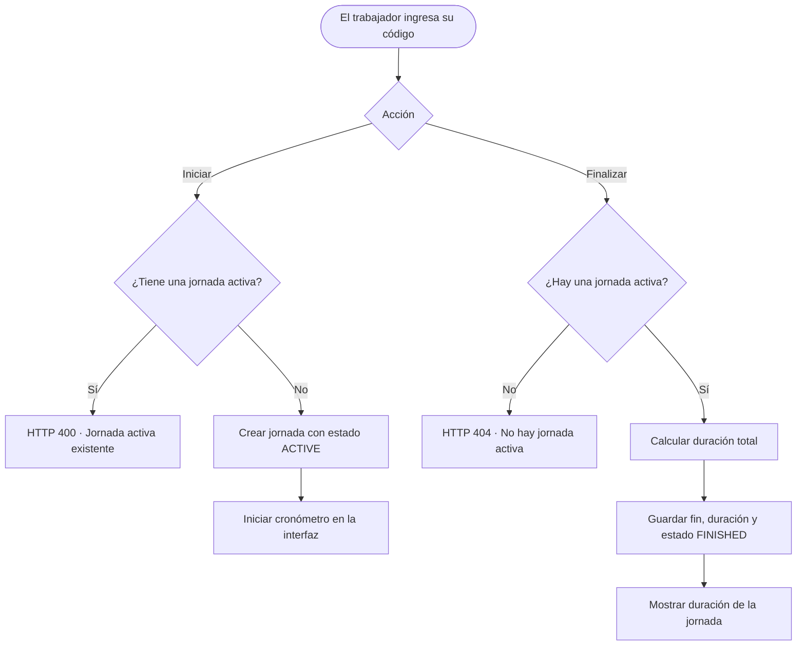
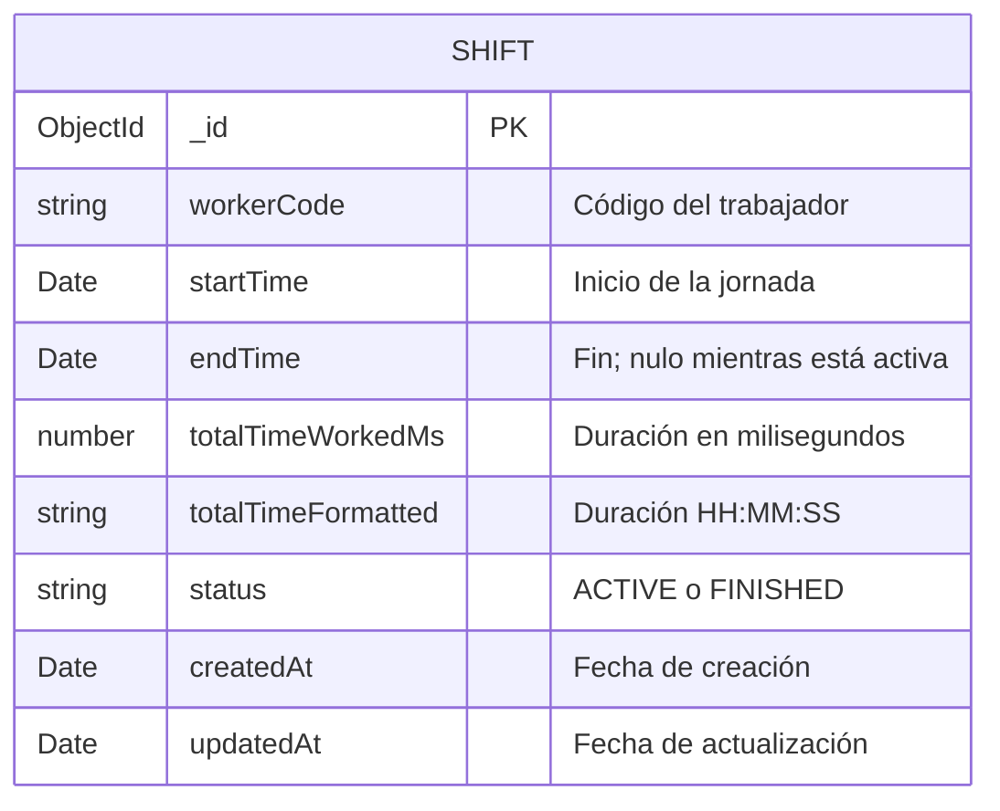

<div align="center">

# Shift

**Aplicación web para registrar y consultar la jornada laboral de empleados.**

[](https://angular.dev/)
[](https://nestjs.com/)
[](https://www.typescriptlang.org/)
[](https://www.mongodb.com/)
[](https://rxjs.dev/)

</div>

## Descripción

Shift es una aplicación full stack para gestionar el inicio y el fin de las jornadas laborales mediante un código de trabajador. La interfaz muestra un cronómetro mientras la jornada está activa; la API valida las operaciones y persiste los registros en MongoDB.

Este proyecto se desarrolló como prueba técnica y utiliza una arquitectura cliente-servidor con una API REST.

## Funcionalidades

- Iniciar una jornada asociada a un código de trabajador.
- Evitar que un trabajador inicie otra jornada si ya tiene una activa.
- Mostrar el tiempo transcurrido en tiempo real en la interfaz.
- Finalizar la jornada y guardar su duración en milisegundos y en formato `HH:MM:SS`.
- Consultar si un trabajador tiene una jornada activa.
- Mostrar mensajes de éxito y error en la aplicación.

## Tecnologías

| Capa | Tecnologías |
| --- | --- |
| Frontend | Angular 18, Angular Material, TypeScript, Reactive Forms, RxJS |
| Backend | NestJS 11, TypeScript, Mongoose, class-validator |
| Persistencia | MongoDB |

## Arquitectura

El frontend Angular consume la API REST de NestJS. El backend encapsula las reglas del dominio en el servicio de jornadas y usa Mongoose para comunicarse con MongoDB.



### Flujo de una jornada



### Modelo de datos



## Requisitos previos

- Node.js y npm.
- Una instancia de MongoDB local o una URI de MongoDB Atlas.

## Configuración y ejecución

El repositorio contiene dos aplicaciones independientes. Ejecuta cada una en una terminal distinta.

### 1. Backend

```bash
cd backend
npm install
```

Configura la URI de MongoDB en `backend/.env`:

```env
MONGO_URI=mongodb+srv://<usuario>:<contraseña>@<cluster>/<base-de-datos>
PORT=3000
```

A continuación, inicia el servidor:

```bash
npm run start:dev
```

La API queda disponible en `http://localhost:3000/api`.

### 2. Frontend

En otra terminal, desde la raíz del repositorio:

```bash
cd frontend
npm install
npm start
```

Abre la URL que muestra Angular CLI en la terminal (habitualmente `http://localhost:4200`).

> No publiques credenciales de MongoDB ni archivos `.env` con secretos en el repositorio.

## API REST

Todas las rutas usan el prefijo `/api`.

| Método | Ruta | Descripción |
| --- | --- | --- |
| `POST` | `/api/shifts/start` | Inicia una jornada. Devuelve `400` si ya existe una jornada activa para el trabajador. |
| `POST` | `/api/shifts/end` | Finaliza la jornada activa y calcula su duración. Devuelve `404` si no existe una jornada activa. |
| `GET` | `/api/shifts/active/:code` | Consulta si el trabajador tiene una jornada activa. |

Las rutas de inicio y finalización reciben un código de trabajador no vacío:

```json
{
  "workerCode": "EMP001"
}
```

Ejemplo para iniciar una jornada:

```bash
curl -X POST http://localhost:3000/api/shifts/start \
  -H "Content-Type: application/json" \
  -d '{"workerCode":"EMP001"}'
```

La ruta de consulta responde con `hasActiveShift` y `data` (el registro de la jornada o `null`). Las operaciones de inicio y finalización devuelven un mensaje y el registro en `data`.

## Pruebas y compilación

### Backend

```bash
cd backend
npm test
npm run test:e2e
npm run test:cov
npm run build
```

### Frontend

```bash
cd frontend
npm test
npm run build
```

## Estructura del repositorio

```text
.
├── backend/   # API REST en NestJS y acceso a MongoDB
└── frontend/  # Aplicación web en Angular
```

## Licencia

No se ha especificado una licencia para este repositorio.
